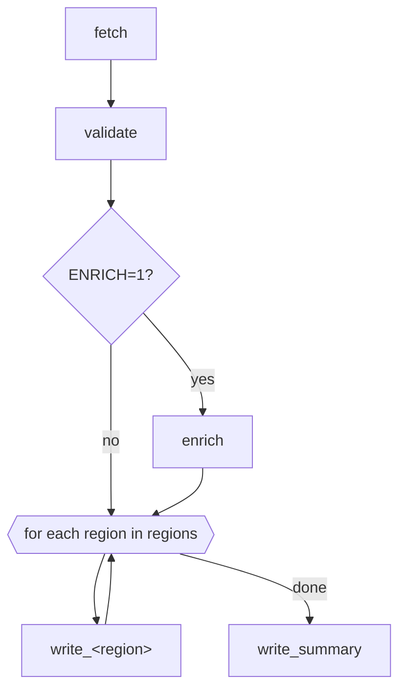

The following contains my preferences and reccomandations for building local tooling scripts.
The intended recipient is a coding agent.


# Script Forge

> Follow these rules when building tooling scripts.

## Tech Stack

* Run with **Bun** + **TypeScript**.
* ⚠️ Run with **as little dependencies as possible**. Every library installed outside Bun core must be **authorized and strongly motivated**.

### Must-have

Always present, no per-script justification needed:

* **`zod`** — typechecking and data validation at every step.
* **`bun test`** (built-in) — unit and integration testing, no install.

### Pre-authorized

Already vetted — bring in only when the trigger condition applies, no need to re-litigate at Planning:

* **`playwright`** — if E2E tests are needed, or for rendering/printing HTML & Markdown to styled PDF documents.
* **`p-limit`** — plain concurrency caps for bounded parallel for-loops.
* **`bottleneck`** — resource/weight-based rate limiting (e.g. LLM token budgets), when a plain concurrency cap isn't enough.
* **`ai`, `@ai-sdk/provider` & provider adaptors** (`@ai-sdk/openai`, `@ai-sdk/anthropic`, etc.) — for LLM orchestration. **Scope constraint:** Restricted strictly to core completion primitives (`generateText`, `generateObject`, `streamText`, `streamObject`, `embed`, `embedMany` + single-turn `tools`). UI hooks, full agent frameworks (e.g. LangGraph or similar graph/agent orchestration libraries), or extra runtime abstractions are forbidden without explicit authorization.
* **`exceljs`** — when reading or writing multi-sheet or styled Excel workbooks (`.xlsx`). (Plain `.csv` uses Bun native parsing).
* **`mammoth`** — for reading Word documents (`.docx`) and converting text directly to clean Markdown/HTML for downstream parsing or LLM ingestion.
* **`docx`** — for programmatically generating or writing Word files (`.docx`).
* **`pdf-parse`** — for extracting UTF-8 text streams from PDF documents.
* **`@js-temporal/polyfill`** — required until the pinned Bun version ships native `Temporal`; pin that Bun version in `package.json` via `engines.bun`. Import the polyfill once at the script entrypoint (`import "@js-temporal/polyfill";`) so it patches the global before any step code runs. Drop this dependency and import as soon as the pinned Bun version has native support; track that removal as a standing cleanup item.
* **`mailparser`** (`.eml`) / **`@kenjiuno/msgreader`** (`.msg`) — for parsing raw MIME and Outlook email files into structured JSON.
* **`sharp`** — when images must be resized, cropped, or converted prior to multimodal/vision LLM ingestion.
* **`hono`** — lightweight HTTP server running natively on Bun when a script must receive or process webhooks.
* **`cheerio`** — when complex CSS selector traversal or deep DOM querying over static HTML is required (otherwise use Bun native `HTMLRewriter`).

Anything outside these lists still needs Planning-time authorization and motivation.

### Development dependencies

Every tooling-script project must have these ESLint development dependencies:

* **`eslint`**
* **`@typescript-eslint/eslint-plugin`**
* **`@typescript-eslint/parser`**
* **`@stylistic/eslint-plugin`**
* **`eslint-plugin-unicorn`**

These belong in `devDependencies`, not runtime `dependencies`.

## Code Standards

Code style and syntax rules are enforced by the repository ESLint configuration. Do not duplicate those rules here; this document defines only constraints that ESLint cannot reliably enforce or that describe runtime/architectural behavior.

### ESLint Configuration

The repository must contain the following ESLint configuration for tooling scripts:

```ts
// eslint.tooling.js
import tseslint from "@typescript-eslint/eslint-plugin";
import tsParser from "@typescript-eslint/parser";
import stylistic from "@stylistic/eslint-plugin";
import unicorn from "eslint-plugin-unicorn";

export default [
	{
		files: ["**/*.ts"],
		languageOptions: {
			parser: tsParser,
			parserOptions: {
				ecmaVersion: "latest",
				sourceType: "module",
			},
		},
		plugins: {
			"@typescript-eslint": tseslint,
			"@stylistic": stylistic,
			unicorn,
		},
		rules: {
			// ---------------------------------------------------------------------
			// 1. STRICT TYPING & SAFETY
			// ---------------------------------------------------------------------
			"@typescript-eslint/no-explicit-any": "error",

			"@typescript-eslint/no-unused-vars": [
				"error",
				{
					argsIgnorePattern: "^_",
					varsIgnorePattern: "^_",
				},
			],

			"@typescript-eslint/consistent-type-imports": [
				"error",
				{
					prefer: "type-imports",
					fixStyle: "inline-type-imports",
				},
			],

			// Ban inline string/code evaluation.
			"no-eval": "error",
			"no-implied-eval": "error",
			"no-new-func": "error",

			// ---------------------------------------------------------------------
			// 2. STYLISTIC & FORMATTING
			// ---------------------------------------------------------------------
			"@stylistic/quotes": ["error", "double", { avoidEscape: true }],
			"@stylistic/semi": ["error", "always"],
			"@stylistic/indent": ["error", "tab"],
			"@stylistic/comma-dangle": ["error", "always-multiline"],

			// ---------------------------------------------------------------------
			// 3. NAMING & FILE CONVENTIONS
			// ---------------------------------------------------------------------
			"unicorn/filename-case": [
				"error",
				{
					case: "camelCase",
					ignore: ["\\.test\\.ts$"],
				},
			],

			"@typescript-eslint/naming-convention": [
				"error",
				{
					selector: "variable",
					format: ["camelCase", "UPPER_CASE"],
					leadingUnderscore: "allow",
				},
				{
					selector: "function",
					format: ["camelCase"],
				},
				{
					selector: "typeLike",
					format: ["PascalCase"],
				},
			],

			"@typescript-eslint/array-type": [
				"error",
				{ default: "array" },
			],

			// ---------------------------------------------------------------------
			// 4. CODE STRUCTURE & MODERN JS
			// ---------------------------------------------------------------------
			"prefer-const": "error",
			"no-var": "error",

			"prefer-destructuring": [
				"error",
				{
					VariableDeclarator: {
						array: true,
						object: true,
					},
					AssignmentExpression: {
						array: false,
						object: false,
					},
				},
			],

			"no-nested-ternary": "error",
			"unicorn/prefer-node-protocol": "error",
			"unicorn/no-array-for-each": "error",

			// Top-level functions are declarations; callbacks are arrows.
			"no-restricted-syntax": [
				"error",

				{
					selector:
						"Program > VariableDeclaration > VariableDeclarator > ArrowFunctionExpression",
					message:
						"Top-level functions must use function declarations; arrows are for callbacks.",
				},
				{
					selector:
						"Program > ExportNamedDeclaration > VariableDeclaration > VariableDeclarator > ArrowFunctionExpression",
					message:
						"Top-level functions must use function declarations; arrows are for callbacks.",
				},
				{
					selector: "FunctionExpression",
					message:
						"Use arrow functions for callbacks; top-level functions must be declarations.",
				},
			],

			// ---------------------------------------------------------------------
			// 5. OPINIONATED DOMAIN BANS
			// ---------------------------------------------------------------------
			"no-restricted-imports": [
				"error",
				{
					paths: [
						{
							name: "dayjs",
							message:
								"Use native global `Temporal` API for date operations.",
						},
						{
							name: "date-fns",
							message:
								"Use native global `Temporal` API for date operations.",
						},
						{
							name: "moment",
							message:
								"Use native global `Temporal` API for date operations.",
						},
						{
							name: "luxon",
							message:
								"Use native global `Temporal` API for date operations.",
						},
					],
					patterns: [
						{
							group: [
								"dayjs/**",
								"date-fns/**",
								"moment/**",
								"luxon/**",
							],
							message:
								"External date libraries are prohibited; use native global `Temporal`.",
						},
					],
				},
			],

			"no-restricted-syntax": [
				"error",

				// Ban parseInt() and Number.parseInt().
				{
					selector: "CallExpression[callee.name='parseInt']",
					message:
						"Use `Number(val)` for parsing instead of `parseInt`.",
				},
				{
					selector:
						"CallExpression[callee.type='MemberExpression'][callee.property.name='parseInt']",
					message:
						"Use `Number(val)` for parsing instead of `Number.parseInt`.",
				},

				// Ban unary '+' parsing.
				{
					selector: "UnaryExpression[operator='+']",
					message:
						"Use `Number(val)` for parsing instead of unary `+`.",
				},

				// Ban z.any(); use z.unknown() instead.
				{
					selector:
						"CallExpression[callee.type='MemberExpression'][callee.object.name='z'][callee.property.name='any']",
					message:
						"Use `z.unknown()` instead of `z.any()`.",
				},

				// Ban direct .env file reads.
				{
					selector:
						"CallExpression[callee.name='readFile'][arguments.0.value='.env']",
					message:
						"Do not read `.env` as a file. Use `process.env`.",
				},
				{
					selector:
						"CallExpression[callee.name='readFileSync'][arguments.0.value='.env']",
					message:
						"Do not read `.env` as a file. Use `process.env`.",
				},
				{
					selector:
						"CallExpression[callee.type='MemberExpression'][callee.property.name='readFile'][arguments.0.value='.env']",
					message:
						"Do not read `.env` as a file. Use `process.env`.",
				},
				{
					selector:
						"CallExpression[callee.type='MemberExpression'][callee.property.name='readFileSync'][arguments.0.value='.env']",
					message:
						"Do not read `.env` as a file. Use `process.env`.",
				},
				{
					selector:
						"CallExpression[callee.type='MemberExpression'][callee.object.name='Bun'][callee.property.name='file'][arguments.0.value='.env']",
					message:
						"Do not read `.env` as a file. Use `process.env`.",
				},
			],
		},
	},
];
```

### Runtime & Architecture

* Run scripts with **Bun** + **TypeScript**.
* Untyped external data must pass through **Zod** at the ingress boundary; derive downstream types from the schema. ESLint can prohibit explicit `any`/`z.any()`, but cannot establish that every external input was correctly validated.
* When using `Number()` for parsing, pair the parsed value with Zod validation, including an explicit `.refine((value) => !Number.isNaN(value))` where `Number()` may produce `NaN`.
* **Fail fast** with early-exit guards, structured error logs, and non-zero exits; avoid nested error branches.

```ts
if (tocIndex < 0) {
	console.log({ error: "TOC page not found", category: "user" });
	process.exit(1);
}
```

The synchronous early-guard pattern above may use `process.exit(n)`. After pending asynchronous I/O has started, set `process.exitCode = n` and let the event loop drain so logs and streams are not truncated.

* Exit codes follow a fixed taxonomy — pair every `process.exit(n)` with the matching `category` in the error log:

| Code | Category | Meaning |
| --- | --- | --- |
| `0` | — | Success |
| `1` | `user` | Bad args, invalid/malformed data, Zod validation failure |
| `2` | `environment` | Missing env var, missing dependency, auth/config failure |
| `3` | `external` | API call failed, network timeout, upstream system down |
| `4` | `internal` | Unexpected/unhandled — treat as a bug, not a user problem |

Uncaught import-time failures can occur before the script can apply this taxonomy; those are outside taxonomy control and present as the runtime's default failure behavior.

`130` is reserved for `SIGINT` by convention — never repurpose it.

### Logging

* Log meaningful progress messages and end with a final summary object containing the result and counts.
* Progress and summary output is still terminal output: it must satisfy **No Naked Data**. Logs are aggregate/anonymized and contain no raw rows or secrets.
* All log output is plain, uncolored text. Tutor Mode and human execution consume the same stdout; there is no separate rendering path to justify ANSI formatting.

### Readability

> Readability means a step is understandable where it stands: a reader should not need to jump across files to see what a script step does. ESLint enforces syntax and style (see the config above); this section covers what lint cannot check.

**Decomposition**

* One purpose per function — if describing what it does needs an "and", split it.
* Keep the flow shallow by extracting small, well-named sub-functions: the main body reads top-down as a list of named calls, and each sub-function is small enough to grasp in place.
* **Prefer co-located sub-functions over new files.** A step's helpers live with the step so it can be understood from its own file. Files exist for composition boundaries (steps, `commons/`), not for readability.
* Avoid nested `if`/`else` — early-exit guards (see **Fail fast** above) keep depth shallow; beyond three levels of nesting, extract.

**Naming**

* Names say what a thing is, not where it came from: `orders` not `result`, `rowCount` not `data`.
* No abbreviations beyond the conventional: `config` yes, `cfg` no.
* Booleans read as predicates: `isValid`, `hasHeader`, `shouldRetry`.
* Never reuse one name for two meanings; don't shadow an outer binding with a local.
* Repeated literals become named constants — `API_TIMEOUT_MS` beats a bare `30_000` appearing twice.

**Comment policy**

* **Why-comments** explain the reasoning behind code, never restate what the code does.
* If a comment is needed to explain what code does, the code needs a name or a split instead — restating comments are noise.
* No commented-out code: delete it, git history owns it.
* Comments carry intent and invariants: why a step exists, what a state row must contain, why a retry is safe.

**Script structure**

* `index.ts` is a thin orchestrator: composes steps, wires inputs/outputs, contains no business logic.
* Steps are self-contained and named for what they do — readable in isolation, no cross-file context required (see **Step Orchestration**).
* Vocabulary consistency: step names, checkpoint state, and log messages use the same terms, so a resume or postmortem reads like the composition.

## Domain Patterns

> Recurring patterns for data formats and LLM calls, applied on top of the Syntax rules above.

### Data I/O

* **Boundary Validation:** Every dataset read from disk, stream, or remote API must pass through a **Zod** schema at the ingress boundary. Derive downstream types directly via `z.infer`.
* **Dates & Timezones:** Use the native global **`Temporal`** API for all date arithmetic, duration parsing, and ISO/timezone formatting. External date libraries (`dayjs`, `date-fns`) are prohibited. This requires the `@js-temporal/polyfill` global patch described in **Tech Stack → Pre-authorized** until the pinned Bun version ships native support.
* **Standardized Ingress/Egress:** Read raw datasets from `local/raw_data/<scriptname>/` or explicit CLI flags. Within that folder:
  * `local/raw_data/<scriptname>/input/` — untouched source dumps, immutable once dropped.
  * `local/raw_data/<scriptname>/archive/` — *(optional)* prior runs' inputs, for recurring scripts that need to diff or reprocess earlier drops.
  * Moving files from `input/` to `archive/` is a **Planning-time decision**: the plan must state whether this is done manually by the user or automatically by the script at a defined point in the run. The chosen lifecycle must be documented in the script's README **Requirements** section.
  Output transformed datasets to dedicated build directories or SQLite databases (`bun:sqlite`), never into `local/raw_data/`, avoiding root-level file dumps.
* **Memory-Conscious Ingress:** Avoid loading large files into memory using full `readFile` operations. Process line-by-line using Node/Bun readable streams or chunked batch iteration.

### Handling Files
* **CSV:** Parse using line streaming or Bun string parsing. Any CSV that is not explicitly guaranteed comma-clean must use a quote-aware parser (a small hand-rolled state machine is acceptable; Bun has no native CSV parser). The naive `split(",")` approach is permitted only as a documented fast path for trusted delimiter-only input.
* **Excel (`.xlsx`):** Read and write workbooks using `exceljs`.
* **Word (`.docx`):** Use `mammoth` to convert incoming `.docx` files straight to Markdown/HTML before passing context to an LLM or database. Use `docx` when generating Word output.
* **PowerPoint (`.pptx`):** Unzip the file buffer natively (or via lightweight `fflate`) and extract slide text from XML tags (`<a:t>`). Do not pull in heavy or unmaintained PowerPoint libraries.
* **PDF:** Extract text streams using `pdf-parse`. For PDF output generation, convert content to HTML/Markdown first and print via Playwright (`page.pdf()`).
* **Email (`.eml` / `.msg`):** Parse email files into structured objects via `mailparser` or `@kenjiuno/msgreader`, validating the output payload with Zod.
* **HTML:** Use Bun's native `HTMLRewriter` for fast streaming tag and text extraction. Fall back to `cheerio` only when complex CSS query selectors are required.

### LLMs

* **Surface Area Constraint:** Restrict `@ai-sdk` usage to raw invocation utilities. Do not import UI hooks, client-side wrappers, or external agent framework utilities. Use `@ai-sdk` whenever streaming, tool-calling, or schema-constrained output (`generateObject`) is needed; use native `fetch` only for one-off unstructured text with no retry, streaming, or tool requirement.
* **Structured Output Enforcer:** All LLM responses intended for downstream execution logic must be constrained by Zod schemas via `generateObject`. Never parse loose Markdown text using custom regex when structured output calls are available.
* **Budget & Rate Control:** Wrap external LLM calls using `p-limit` for concurrency caps or `bottleneck` for rate/token limits. Unbounded `Promise.all` over LLM endpoints is forbidden.
* **Fault Handling & Classification:** Model API rate limits (HTTP 429), timeouts, or server errors (HTTP 5xx) must be caught, logged as structured objects, and retried with intra-call exponential backoff for a bounded number of attempts (using `bottleneck` retry support or an explicit wrapper) before escalating to category `external` (exit code `3`) and the checkpoint-restart path.
* **Privacy at Planning:** Before wiring an LLM call into a script, explicitly define during **Planning** whether payload data requires PII masking, local/self-hosted execution (e.g., Ollama or vLLM), or specific vendor data-retention guarantees.
* **Prompt Files:** Prompts live as Markdown files under `assets/prompts/` (see **Scaffolding**). No templating library is authorized for this — it would violate the minimal-dependency rule for a problem plain TypeScript already solves. A prompt file is delimited frontmatter + body:

  `assets/prompts/summarize.md`
  ```md
  ---
  id: summarize
  description: Summarize order stats for a human reader
  model: gpt-4o-mini
  ---
  Summarize this order data in one sentence: {{stats}}
  ```

  Frontmatter is validated with **Zod**; variable substitution is a native `{{var}}` regex replace — no dependency required:

  `commons/loadPrompt.ts`
  ```ts
  import { readFile } from "node:fs/promises";
  import { z } from "zod";

  const promptMeta = z.object({
    id: z.string(),
    description: z.string(),
    model: z.string(),
  });
  type PromptMeta = z.infer<typeof promptMeta>;

  // Splits frontmatter/body, validates meta, exposes a render fn — no templating lib needed.
  export async function loadPrompt(path: string) {
    const raw = (await readFile(path, "utf8"))
      .replace(/\r\n/g, "\n")
      .trim();
    const [, fm, body] = raw.match(/^---\n([\s\S]+?)\n---\n([\s\S]*)$/) ?? [];
    if (!fm || !body) {
      console.log({ error: "malformed prompt file", category: "user", path });
      process.exit(1);
    }

    const meta: PromptMeta = promptMeta.parse(
      Object.fromEntries(
        fm.split("\n").map((line) => line.split(/:\s(.+)/).slice(0, 2) as [string, string])
      )
    );

    const render = (vars: Record<string, string>) =>
      body.trim().replace(/{{(\w+)}}/g, (_, key) => vars[key] ?? "");

    return { meta, render };
  }
  ```

  `steps/summarize.ts`
  ```ts
  import { generateText } from "ai";
  import { openai } from "@ai-sdk/openai";
  import { loadPrompt } from "../commons/loadPrompt";

  const { meta, render } = await loadPrompt("assets/prompts/summarize.md");

  const { text } = await generateText({
    model: openai(meta.model),
    prompt: render({ stats: "1284 orders, avg $42.50" }),
  });

  console.log({ summary: text });
  ```

### Networking
* Use **hono** to handle webhook workflows.
* **Reachability**: Working with webhooks needs a tunnel. Address this as a required operational step during Planning using ngrok.
* **Signature verification**: HMAC/signature check on incoming payloads (Stripe-Signature, X-Hub-Signature-256, etc.) is mandatory.
* **No Naked Data** applies to recieving payloads too.
* A webhook needs its own stop condition (e.g. timeout) defined in Planning phase.

## Plugin userConfig

> The plugin reads a few user-level keys from Claude Code settings (the `userConfig` block of the plugin manifest). Unset or empty means "use the default below".

* `defaultNamespace` (default `tools`) — the `<namespace>:<scriptname>` alias namespace used when registering scripts in `package.json` (see Scaffolding → Proper scripts).
* `scaffoldDirectory` (default: the current working directory) — absolute path where the `scaffold` command creates new workspaces. Empty = wherever the command runs.
* `scriptsDirectory` (default `scripts`) — workspace-relative directory where proper scripts live.
* `localDirectory` (default `local`) — workspace-relative scratch root; the `tmp/` (temp-tools) and `raw_data/` (No Naked Data) children hang off it.
* `esLintConfigLocation` (default: the plugin's `skills/anvil/assets/eslint.tooling.js`, resolved from the plugin install root, forward slashes) — absolute path to the ESLint flat config projects point at via `--config`. A custom config resolves its own imports relative to its own location; the plugin-default config resolves them from the plugin install's `node_modules`.

Throughout this rulebook, `scripts/`, `local/tmp`, `local/raw_data`, and `scripts/<scriptname>/` mean the **configured** directories — in skill and command docs they interpolate as `${user_config.scriptsDirectory}`, `${user_config.localDirectory}`, etc., with the defaults above when a key is unset or empty.

### LLM provider & model — asked at runtime

Prompt files carry a `model:` in their frontmatter. There is **no config default for provider or model**: when creating a prompt file, ask the user for the provider and the model at that moment, presenting the current default model for each provider — looked up at ask time (current model docs / web search), never a stale baked-in list, never from memory.

## Scaffolding

> Where a script lives depends on its lifecycle stage: disposable investigation vs. a permanent, referenceable tool.

### Temp-tools → `local/tmp`

* One-off scripts for Planning or investigating go into `local/tmp` (gitignored).
* Raw datasets are dropped into `local/raw_data` (gitignored) — see **No Naked Data**.
* You may decide to promote a temp-tool into a proper script (see below). If so, propose it to the User first.
* Treat `local/tmp` as fully disposable — no persistence guarantee, no mid-session cleanup ceremony.
* On promotion to `scripts/`, delete the temp-tool version in the same commit — Clean Kitchen applies to the file's own lifecycle too.
* At the start of a new planning session, sweep `local/tmp` of anything not referenced by the current task — judgment call, no fixed TTL.
* If something in `local/tmp` needs to survive across sessions, that's a signal to either promote it or log the reason to auto-memory — not leave it implicit.

### Proper scripts → `scripts/<scriptname>/`

* **Every proper script uses this structure, with no exception for mono-step scripts.** A script small enough to fit in one file still gets the full layout below — consistency across `scripts/` matters more than saving a folder for trivial cases.

```
scripts/<scriptname>/
├── index.ts               # entrypoint — orchestrates steps, see Step Orchestration
├── commons/                # functions shared across steps
├── steps/                  # one .ts file per step (or a generic file for dynamically-generated steps)
├── tests/
│   ├── bun/                 # unit + integration tests (*.test.ts)
│   ├── playwright/          # optional, e2e tests
│   └── fixtures/            # shared by bun test and playwright
├── assets/
│   └── prompts/             # optional, LLM prompt files (see LLMs → Prompt Files)
└── README.md               # required, see Documentation
```

* Reference every script in `package.json` as `<namespace>:<scriptname>` and run it from there with **Bun**, e.g. `"tools:ordersSummary": "bun run scripts/ordersSummary/index.ts"` → `bun run tools:ordersSummary`. `<namespace>` groups scripts by domain (e.g. `tools`, `reports`) — reuse an existing namespace when the script fits one, don't mint a new one per script.

## Step Orchestration

> `index.ts` composes the step list before running it. Step order can be dynamic — built with plain `if`/`else` and `for`-loops — rather than encoded in filenames. This is deliberately handled in-house: LangGraph and similar graph/agent-orchestration libraries are rejected (see **LLMs → Surface Area Constraint**) because they duplicate and compete with **Checkpoint & Resume** rather than complement it.

**Step schema** (`commons/stepSchema.ts`):

```ts
import { z } from "zod";

export const stepContext = z.object({
  get: z.function().args(z.string()).returns(z.unknown()),
  set: z.function().args(z.string(), z.unknown()).returns(z.void()),
});
export type StepContext = z.infer<typeof stepContext>;

export const stepDef = z.object({
  name: z.string(),                  // must match stepRow.step in the state db
  run: z.function().args(stepContext).returns(z.promise(z.void())),
  rollback: z.string().nullable(),   // description of compensating action, or null
  rollbackFn: z.function().args(stepContext).returns(z.promise(z.void())).nullable(),
});
export type StepDef = z.infer<typeof stepDef>;

export const stepList = z.array(stepDef).min(1);
```

**Dynamic composition — conditional step + loop-generated steps** (`index.ts`):

```ts
import { stepList } from "./commons/stepSchema";
import { fetchStep, validateStep, enrichStep, writeStep, perRegionStep } from "./steps";
import { runStep } from "./commons/runner"; // wraps Checkpoint & Resume sqlite logic

const needsEnrichment = process.env.ENRICH === "1";
const regions = ["eu", "us", "apac"];

const steps = stepList.parse([
  { name: "fetch", run: fetchStep, rollback: null, rollbackFn: null },
  { name: "validate", run: validateStep, rollback: null, rollbackFn: null },
  ...(needsEnrichment
    ? [{ name: "enrich", run: enrichStep, rollback: "delete enrichment cache", rollbackFn: null }]
    : []),
  ...regions.map((region) => ({
    name: `write_${region}`,
    run: () => perRegionStep(region),
    rollback: `delete output rows for region=${region}`,
    rollbackFn: null,
  })),
  { name: "write_summary", run: writeStep, rollback: null, rollbackFn: null },
]);

for (const step of steps) {
  await runStep(step);
}
```

`null` rollbacks still require an explicit Planning-time warning per the **Checkpoint & Resume** corollary — dynamic composition doesn't exempt any step from that rule.

## Documentation

> Every proper script under `scripts/<scriptname>/` ships a `README.md` alongside it. This replaces any repository-wide `docs/` folder for script documentation — there is no separate `docs/` location, documentation is colocated with the script it describes.

**Required structure:**

* **Frontmatter** — `title`, `purpose`, `initial input`, `final output`, `run` (the `package.json` script alias, e.g. `tools:ordersSummary`), `namespace`.
* **One Mermaid diagram** representing the execution flow, decision points, and loops. Default to a single diagram per script regardless of complexity — no size-based exception. Since step composition can be dynamic, the diagram represents the superset of possible steps, using decision diamonds for conditionals and loop-back edges for generated steps. Example, for the `index.ts` above:



* **One section per step**, containing:
  * name
  * input
  * output
  * rollback (the compensating action, or explicitly `null` — mirrors the step's `rollback` field) and whether a `rollbackFn` is implemented for it or the rollback is manual-only
  * checkpoint key naming pattern — for a fixed step this is the literal name; for dynamically-generated steps, state the pattern instead of enumerating instances (e.g. "one `write_<region>` step per entry in `regions`")
  * a bullet list of what the step does, in order (the *why* stays in code comments, not here)
  * a link to the step's file
* **Requirements** — final section, covering:
  * environment variables
  * ngrok / tunnel needs, if any
  * non-standard dependencies used (anything from the Pre-authorized list beyond Zod) — this is the audit trail for "authorized and strongly motivated"
  * expected shape/contents of `local/raw_data/<scriptname>/input/`

**Sync obligation:** editing `steps/` or the control flow in `index.ts` requires updating `README.md` (step sections and diagram) in the same commit. This falls under **Clean Kitchen** — a stale diagram or step list is exactly the kind of mess that principle forbids leaving behind.

## Principles

Always follow these principles, to the letter.

### 📊 No Naked Data

> Never let raw data reach the coding assistant's own context: while investigating or debugging, build TypeScript scripts that read the full dataset but print only anonymized statistics back to the terminal.

> ⚠️ This principle applies specifically to the coding assistant's context (e.g., terminal output, file reads during development), not to every LLM call executed by a running script. It also covers error objects and stack traces: sanitize them before logging and never dump raw rows from catch blocks. Local SQLite inspection must use the same stats-only script pattern; never run raw `sqlite3 ... select *` output into Claude's context. Local/self-hosted LLM calls are exempt from external-vendor privacy scrutiny, but not from the terminal/context exposure rule. Refer to **Domain Patterns → LLM Integration & Orchestration** for handling LLMs in scripts.

**✅ GOOD — scripts only, stats out**

```ts
// local/tmp/ordersSummary.ts — run with: bun run local/tmp/ordersSummary.ts
// The script reads the dump, but only anonymized statistics reach the screen (and Claude).
// This illustrative example assumes a small, size-bounded file; unknown or large inputs must use streaming/chunked ingestion.
import { readFile } from "node:fs/promises";
import { z } from "zod";

// Zod validates every row before any computation touches it.
const orderRow = z.object({
  date: z.string(),
  customer: z.string(),
  amount: z.number().positive(),
});

const [, ...lines] = (await readFile("local/raw_data/orders.csv", "utf8"))
  .trim()
  .split("\n");

const rows = lines.map((line) => {
  const [date, customer, amount] = line.split(",");
  return orderRow.parse({ date, customer, amount: Number(amount) });
});

const totalOrders = rows.length;
const avgOrderValue =
  rows.reduce((sum, row) => sum + row.amount, 0) / totalOrders;

console.log({ totalOrders, avgOrderValue });
// → { totalOrders: 1284, avgOrderValue: 42.5 }

```

**❌ BAD — reading the dump directly**

```bash
# 🚫 The raw dump (customer names, emails, amounts) passes straight through to Claude's context.
cat local/raw_data/orders.csv | head -50

```

```ts
// 🚫 Same problem: this prints every raw row, PII and all.
import { readFile } from "node:fs/promises";
console.log(await readFile("local/raw_data/orders.csv", "utf8"));

```

### 🧹 Clean Kitchen

> You own the code you're writing or evolving. Your scope always includes fixing pre-existing bugs and technical debt directly touched by or adjacent to the current diff. Your responsibility is to evolve the codebase so it stays readable, tidy and scalable — leave the kitchen cleaner than you found it. Unrelated issues spotted along the way are out of scope for inline fixes: surface them to the user, or log them to auto-memory, rather than expanding the diff.

> For the concrete readability rules — decomposition, naming, comments, script structure — see **Code Standards → Readability**.

**✅ GOOD — you own it, leave it cleaner**

```ts
// 🎯 Task: add a `--json` flag to scripts/ordersSummary/steps/summarize.ts.
// While editing, you spot a pre-existing bug: averages are computed on rows
// that were never validated with Zod. Not your bug? Doesn't matter — you own
// this code now. Fix it and pin the fix with a regression test.

const rows = lines.map(parseLine); // ✅ Zod-validated (was: raw split lines)
const avgOrderValue =
  rows.reduce((sum, row) => sum + row.amount, 0) / rows.length;

```

**❌ BAD — "not my bug", leave a mess**

```ts
// 🎯 Same task. The pre-existing bug stays, hidden behind a TODO "for later",
// and a scratch file is dumped next to the script — nobody cleans up after you.

const rows = lines.map(parseLine);
const avg =
  rows.reduce((sum, row) => sum + Number(row.amount), 0) / rows.length; // TODO: fix later

await writeFile("debug.json", JSON.stringify(rows)); // 💩 dumped, never cleaned

```

### 🔁 Checkpoint & Resume

> Multi-step scripts persist state per step and are re-runnable from any step. Every side effect is logged with its own compensating (rollback) action — or an explicit `null` if none exists — so a failed run can be resumed or unwound without guesswork.

**State store** — one `bun:sqlite` file per script run (WAL mode), not flat JSON: transactions make checkpoint writes atomic, and parallel steps can write without a hand-rolled file lock. This is a run-state database, separate from any `bun:sqlite` output database the script writes under **Domain Patterns → Data Reading & Writing**. A table row per step, minimally:

```ts
const stepRow = z.object({
  step: z.string(),
  status: z.enum(["pending", "done", "failed"]),
  ranAt: z.string(), // ISO timestamp
  action: z.string(), // JSON describing what this step did and any state needed for resume/postmortem
  rollback: z.string().nullable(), // compensating action description, or null if none exists
});

```

**Resume** — resume happens in a fresh process. No step may assume in-memory continuity: required inputs must either be re-derived from source/build output or be persisted in the state's `action` field as JSON and re-read on resume. On start, read the table; skip steps marked `done`, restart from the first `pending` or `failed` row.

**Dynamic step reconciliation** — on resume, rows in the state DB with no matching step in the current composition are flagged as **orphaned** and require explicit confirmation before proceeding. Steps present in the current composition with no DB row start fresh as `pending`.

**Rollback (the Corollary, made concrete)** — on failure, replay `done` rows in reverse. If the current step definition provides `rollbackFn`, invoke it; otherwise surface the descriptive `rollback` string as a required manual action for the operator. A `null` rollback is not a silent gap: it's a recorded fact Planning can check for — any step with `rollback: null` must carry an explicit warning raised during Planning, per the Implementing corollary.

**Torn state & idempotency** — mark a step `done` only after its local write/checkpoint succeeds. Every step that performs an external side effect must be idempotent or use a check-before-act strategy that queries the external system for an existing effect, so a resume retry after a torn state cannot duplicate the side effect.

### 🚫 Eval is Banned

> Never execute inline code to inspect the repository or the data. Order of preference for investigating:
> 1. **`Read`, `Glob`, or `Grep`** — Claude Code tools, always first.
> 2. **`Bash` or `PowerShell`** — `PowerShell` when the task needs structured object piping, multi-step file/registry manipulation, or Windows-specific tooling; `Bash` for everything else.
> 3. **Temp-tools** — if you need a real script, write one (see Scaffolding).
> Never use `eval()` or other inline executions. Don't use **Python** or other scripting languages.

**✅ GOOD — tools first, scripts for the rest**

```bash
# 1. Inspect with Claude Code tools: Read, Glob, Grep
# 2. Shell work — Bash for simple cases:
ls local/tmp
# 2. Shell work — PowerShell for structured/Windows-specific cases (not shown)

# 3. Real data crunching → write a temp-tool (see No Naked Data):
bun run local/tmp/extractStats.ts

```

**❌ BAD — inline execution, never**

```bash
# 🚫 The raw dump (PII and all) passes straight through to Claude's context.
bun -e "console.log(require('fs').readFileSync('local/raw_data/orders.csv', 'utf8'))"

```

```js
// 🚫 eval() and friends — banned, no exceptions.
eval("console.log(fs.readFileSync('local/raw_data/orders.csv', 'utf8'))");

```

```bash
# 🚫 Other scripting languages are banned too.
python -c "print(len(open('local/raw_data/orders.csv').readlines()))"

```

### 🔒 Never Read `.env`

> Secrets never enter the session: `.env` is never read as a file — the pinned Bun version (see `engines.bun` in **Tech Stack**) auto-loads it, so config comes from `process.env`.

**✅ GOOD — config via process.env**

```ts
const apiToken = process.env.API_TOKEN; // Bun loads .env automatically

```

**❌ BAD — reading the file**

```ts
import { readFile } from "node:fs/promises";
const secrets = await readFile(".env", "utf8"); // 🚫 secrets pass through the session

```

> ESLint bans this too (`no-restricted-syntax`), and lint covers the temp-tools directory — this principle carries the rule for temp-tools.

### 🧠 Memory

> Durable conventions and facts you state belong in **this doc** — not in auto-memory. What Claude discovers *while working* (build quirks, debug insights, preferences you mention in passing) goes to auto-memory, auditable anytime with `/memory`.

## Implementation

> The lifecycle every script goes through: Planning → Implementing → Validating → Running.

> **Environment assumption:** this document targets a **Claude Code** environment; bare tool names such as `Read`, `Glob`, `Grep`, `WebSearch`, `WebFetch`, `Agent`, and `AskUserQuestion` refer to Claude Code built-ins.

### Planning

Use **plan mode** when the approach is uncertain, the change spans multiple files, or the code is unfamiliar — skip it when the diff is describable in one sentence. A good plan:

* Is backed by extensive research.
* Use **subagents** (Agent tool) that return **structured, synthetic findings** to preserve the session scope.
* Use `WebSearch` and `WebFetch` (always wrapped in a subagent) to ground and validate products or pattern best practices.
* Always apply **No Naked Data** in your investigations.
* Has a clear and validated scope.
* **Discovery before questions:** investigate first using `Read`, `Grep`, `WebSearch`, `WebFetch`, and subagents. Agent-side resolution is preferred when the codebase or available evidence can answer the question without user input.
* Only unresolved questions go to the user via sequential `AskUserQuestion` batches of approximately 2–4 questions, grouped by topic, with a hard cap of 2 batches (about 8 questions total). If open questions remain after that, proceed with explicit **⚠️ Assumptions** in the plan that the user can veto rather than continuing to ask.
* Outlines a clear series of steps with clear boundaries that brings you to the goal with certainty, without skipping any.
* Includes validation steps and checkpoints to raise quality (see Validating).
* Ends with a final step to update the script's own `README.md` (see **Documentation**).

### Implementing

* Scripts should be executable in a single **bash** command.
* Apply **Checkpoint & Resume** (see Principles): multi-step scripts maintain state per step and are re-runnable from any step; on error, restart from the last available checkpoint.
* Corollary: side effects must be documented and have a clear rollback procedure, per **Checkpoint & Resume**. If a rollback isn't possible, a warning must be raised during Planning.
* Scripts should log meaningful progress messages and errors: `console.log()` output should be tested so it can be used for troubleshooting.
* Scripts — especially when for-loops are involved — should be optimized for speed and parallelism (see Pre-authorized libraries: `p-limit`, `bottleneck`).
* Aim for a **Clean Kitchen**.

### Validating

* Validate TypeScript types: `bunx tsc --noEmit`.
* Validate syntax with **ESLint**: `bun run lint`.
* Write and run unit tests and integration tests, following a TDD approach: `RED` → `GREEN` → `REFACTOR`.
* Unit tests should cover positives, negatives, edge cases, faults and error handling.
* Integration tests should also account for failures and errors from external systems (executed commands, API calls, etc.).
* **Unit tests** never touch the network — mock the API client/fetch call entirely, no exception.
* **Third-party API fixtures:** prefer, in order: (1) obtain a real example response from the API's own docs via `WebSearch`/`WebFetch`, or ask the user to paste one from their own account/logs if docs are thin or gated; no live call is required for this path; (2) if that fails, use record-then-mock only with explicit user authorization, making one real **sandboxed** call to capture the response shape and persisting it as a fixture; (3) hand-author a mock from memory only as a last resort, and flag it as unverified in the README/PR.
* **Complex third-party APIs:** a record-then-mock workflow is permitted: implement against the sandbox, capture real responses into fixtures, then backfill tests. Keep strict RED → GREEN → REFACTOR for pure logic and transformation code.
* **Integration tests** should otherwise use recorded fixtures/mocks rather than live APIs by default; do not instrument the shipped script for test mode solely to enable this. Set `RUN_MOCK_API_TESTS=1` when isolating an execution against recorded fixtures is useful (success, rate-limit, 4xx, 5xx, malformed response — one file per scenario, under `tests/fixtures/`).
* Fixture content follows **No Naked Data**: no real tokens, real PII, or real customer data.
* Write and run E2E tests with **Playwright** if the requirements cover multiple use cases (one file per use case, one test per use-case variation).

## Running

Always run scripts in **Tutor Mode**: you watch the logs while Claude drives the script — fix, restart from checkpoint, postmortem.

* The session stays open and you watch the logs as the script runs.
* On a technical error or bug, aim for a **Clean Kitchen**: fix it, then restart from the last available checkpoint (or from the start, worst case).
* The natural termination of the script (Success or Functional Error) is followed by a postmortem execution summary from your end.

> **Run the script only after the User's explicit consent.** “The script” means a real invocation of `scripts/<name>` that performs the requested business operation. Validation commands (`tsc`, ESLint, tests) and disposable `local/tmp` investigation tools are implicitly authorized as part of the workflow and do not require per-run consent.
