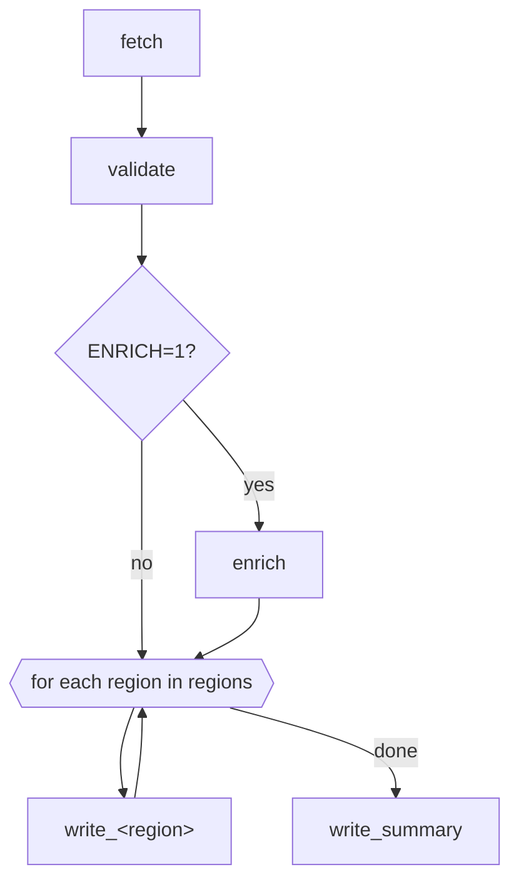

# Documentation

> Source: Script Forge rulebook, **Documentation**. Every proper script ships a colocated README; there is no separate `docs/` location.

> Every proper script under `${user_config.scriptsDirectory}/<scriptname>/` (default `scripts/`) ships a `README.md` alongside it. This replaces any repository-wide `docs/` folder for script documentation — there is no separate `docs/` location, documentation is colocated with the script it describes.

**Required structure:**

* **Frontmatter** — `title`, `purpose`, `initial input`, `final output`, `run` (the `package.json` script alias, e.g. `tools:ordersSummary`), `namespace`.
* **One Mermaid diagram** representing the execution flow, decision points, and loops. Default to a single diagram per script regardless of complexity — no size-based exception. Since step composition can be dynamic, the diagram represents the superset of possible steps, using decision diamonds for conditionals and loop-back edges for generated steps. Example, for the `index.ts` in **lifecycle.md → Step Orchestration**:

* **One section per step**, containing:
  * name
  * input
  * output
  * rollback (the compensating action, or explicitly `null` — mirrors the step's `rollback` field) and whether a `rollbackFn` is implemented for it or the rollback is manual-only
  * checkpoint key naming pattern — for a fixed step this is the literal name; for dynamically-generated steps, state the pattern instead of enumerating instances (e.g. "one `write_<region>` step per entry in `regions`")
  * a bullet list of what the step does, in order (the *why* stays in code comments, not here)
  * a link to the step's file
* **Requirements** — final section, covering:
  * environment variables
  * ngrok / tunnel needs, if any
  * non-standard dependencies used (anything from the Pre-authorized list beyond Zod) — this is the audit trail for "authorized and strongly motivated"
  * expected shape/contents of `${user_config.localDirectory}/raw_data/<scriptname>/input/` (default `local/raw_data/`)

**Sync obligation:** editing `steps/` or the control flow in `index.ts` requires updating `README.md` (step sections and diagram) in the same commit. This falls under **Clean Kitchen** — a stale diagram or step list is exactly the kind of mess that principle forbids leaving behind.

> When writing a script's README, start from the slot shape in `assets/readme.template.md` (anvil asset).
